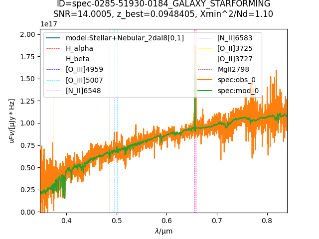
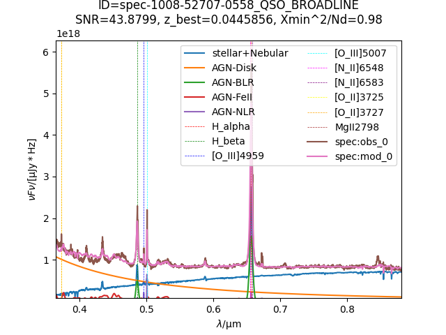
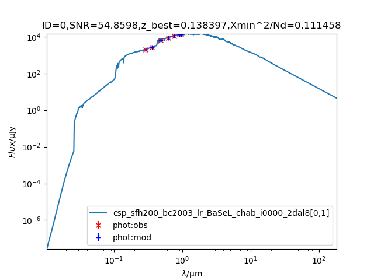
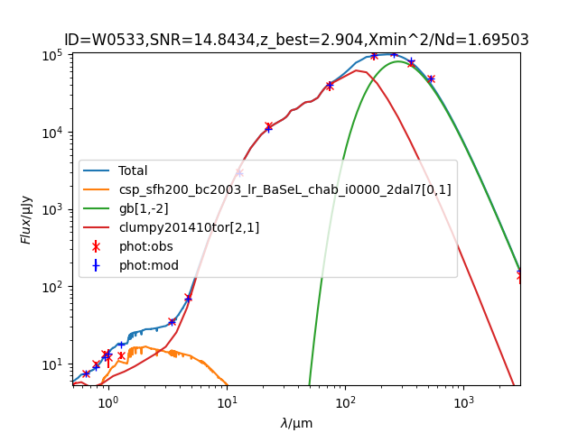
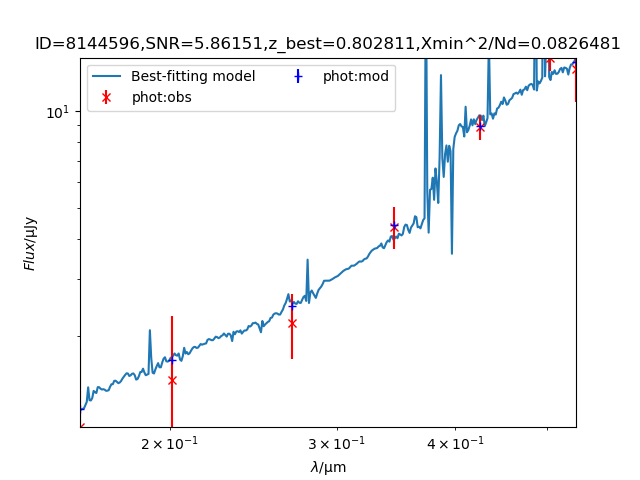
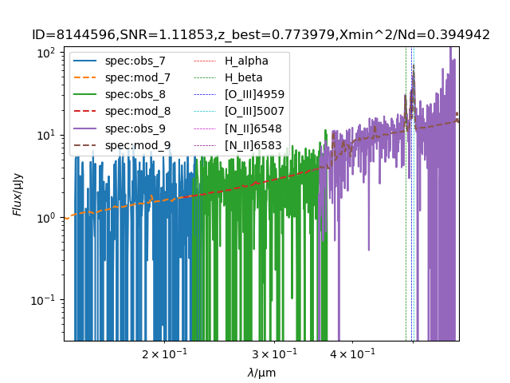
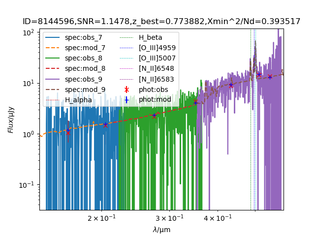
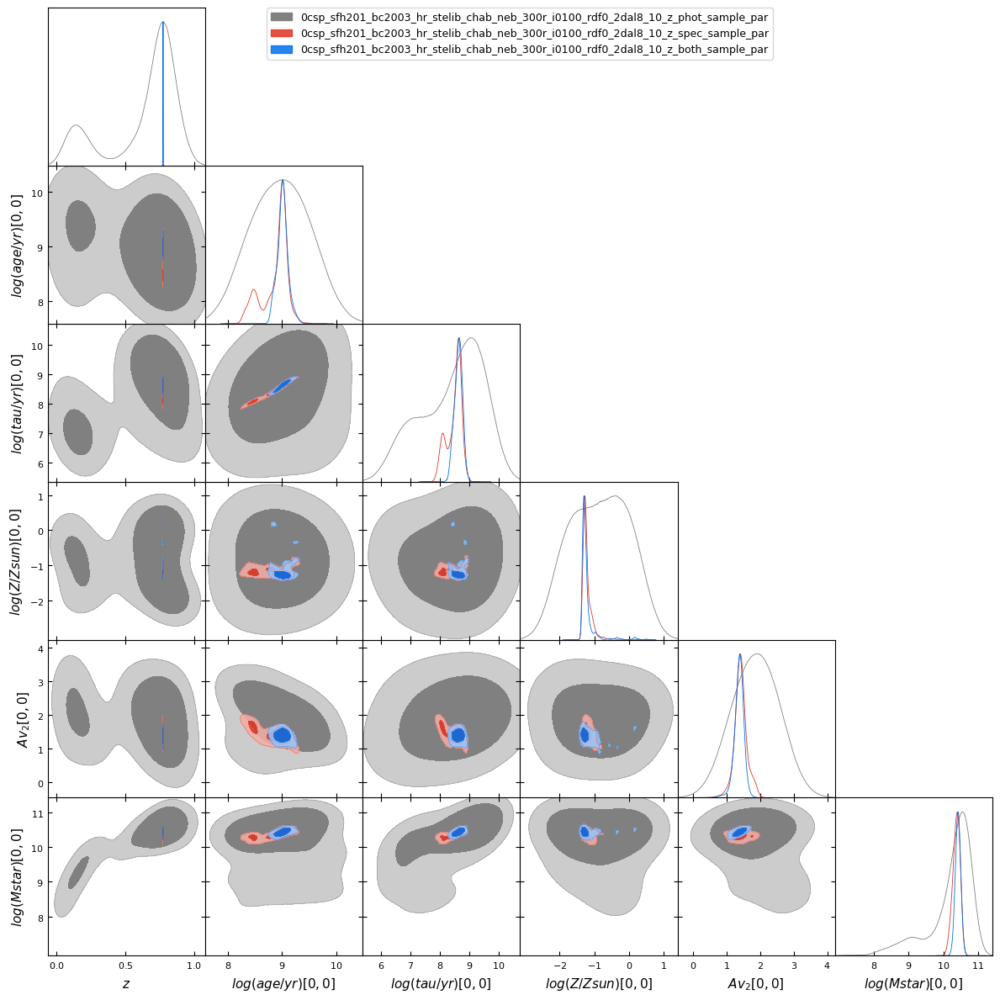
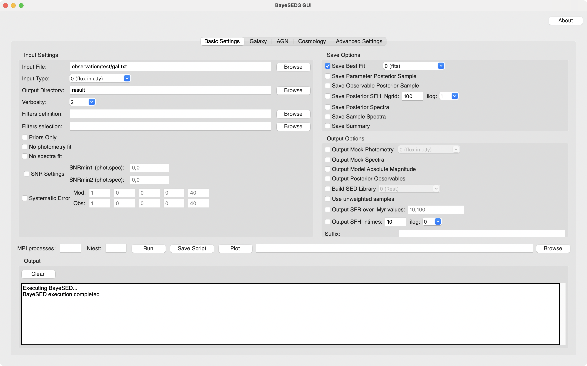

# BayeSED3: A code for Bayesian SED synthesis and analysis of galaxies and AGNs

<p align="center">
  
  <br>
  <em>"With four parameters I can fit an elephant, and with five I can make him wiggle his trunk."</em>
  <br>
  <small>- Attributed to John von Neumann</small>
</p>

BayeSED3 is a general and sophisticated tool for the full Bayesian interpretation of spectral energy distributions (SEDs) of galaxies and AGNs. It performs Bayesian parameter estimation using posterior probability distributions (PDFs) and Bayesian SED model comparison using Bayesian evidence. BayeSED3 supports various built-in SED models and can emulate other SED models using machine learning techniques.

## Key Features

- **Explore the [BayeSED3-AI Assistant 🚀](https://udify.app/chat/Gmni8M7sHDKWG67F) or [](https://deepwiki.com/hanyk/BayeSED3) for interactive help and guidance!**
- Multi-component SED synthesis and analysis of galaxies and AGNs
- Flexible stellar population synthesis modeling
- Flexible dust attenuation and emission modeling
- Flexible stellar and gas kinematics modeling
- Non-parametric and parametric star formation history options
- Comprehensive AGN component modeling (Accretion disk, BLR, NLR, Torus)
- Intergalactic medium (IGM) absorption modeling
- Handling of both photometric and spectroscopic data
- Bayesian parameter estimation and model comparison
- Machine learning techniques for SED model emulation
- Parallel processing support for improved performance
- User-friendly CLI, Python script and GUI interfaces

## Installation

**Platforms:** Linux x86_64 · macOS (x86_64 and ARM64) · Windows via WSL (Linux binaries)

### OpenMPI 4.1.6

Required. pip does not install it. BayeSED3 looks for conda, system, or a local build; if none is found it will try to compile OpenMPI 4.1.6 itself.

```bash
conda install -c conda-forge openmpi=4.1.6
```

Or a system package: Ubuntu/Debian `sudo apt-get install openmpi-bin openmpi-common libopenmpi-dev` · Fedora `sudo dnf install openmpi openmpi-devel` · macOS `brew install openmpi`.

Compile from source (optional):

```bash
wget https://download.open-mpi.org/release/open-mpi/v4.1/openmpi-4.1.6.tar.gz
tar xzvf openmpi-4.1.6.tar.gz
cd openmpi-4.1.6
./configure --prefix=$PWD/../openmpi
make
make install
```

### pip

```bash
pip install -U git+https://github.com/hanyk/BayeSED3.git           # latest (main)
#pip install -U git+https://github.com/hanyk/BayeSED3.git@v2026.08.23  # release

git clone https://github.com/hanyk/BayeSED3.git && cd BayeSED3                                    # latest (main)
# wget -O BayeSED3-2026.08.23.zip https://github.com/hanyk/BayeSED3/archive/refs/tags/v2026.08.23.zip && unzip BayeSED3-2026.08.23.zip && cd BayeSED3-2026.08.23
pip install -e .                                                   # editable
pip install -U .                                                   # non-editable
pip install -e '.[gui]'                                            # GUI

bayesed3                                                           # CLI
pip uninstall bayesed3
```

### Optional components

**HDF5 utilities** (optional):
- Ubuntu/Debian: `sudo apt-get install h5utils`
- Fedora: `sudo dnf install hdf5-tools`
- macOS (with Homebrew): `brew install h5utils`

**tkinter** (required for GUI):
- Ubuntu/Debian: `sudo apt-get install python3-tk`
- Fedora: `sudo dnf install python3-tkinter`
- macOS (with Homebrew): `brew install python-tk`

## Usage examples

Run from the repository root.

1. SDSS spectroscopic SED analysis
   ```
   python tests/run_test.py gal plot --Ntest 1
   python tests/run_test.py qso plot --Ntest 1
   ```



2. photometric SED analysis
   ```
   python tests/run_test.py test1 plot
   python tests/run_test.py test2 plot
   ```



3. mock CSST photometric and/or spectroscopic SED analysis
   ```
   python tests/run_test.py test3 phot plot
   python tests/run_test.py test3 spec plot
   python tests/run_test.py test3 both plot
   ```





4. [A new approach to constraining properties of AGN host galaxies by combining image and SED decomposition](https://ui.adsabs.harvard.edu/abs/2024arXiv241005857Y/abstract)

jupyter-notebook [observation/agn_host_decomp/demo.ipynb](observation/agn_host_decomp/demo.ipynb)

### Python Interface

**Quick Start Examples:**

```python
from bayesed import BayeSEDParams, SEDInference, BayeSEDInterface, BayeSEDResults

params = BayeSEDParams.galaxy(
    input_file='observation/test/gal.txt',
    outdir='tests/output_quick_start',
    ssp_model='bc2003_hr_stelib_chab_neb_2000r',
    sfh_type='exponential',
    dal_law='calzetti',
    save_sample_par=True,  # needed for posterior plots
)

inference = SEDInference()
inference.priors_init(params)
# Optional: inference.set_prior('log(age/yr)', min_val=8.5, max_val=9.8, confirm=False)
results = inference.run(params, Ntest=2)  # Results: posteriors, evidence, plots
# execution = BayeSEDInterface(Ntest=2).run(params)  # Execution: stdout, parameter list, returncode
# results = BayeSEDResults(params.outdir, catalog_name='gal')

results.print_summary()

# Access parameters and objects
free_params = results.get_free_parameters()
available_objects = results.list_objects()

# Load all parameters as astropy Table from HDF5 file
hdf5_table = results.load_hdf5_results()
# Built-in SNR filtering
high_snr_table = results.load_hdf5_results(filter_snr=True, min_snr=5.0)

# Access all statistical estimates for specific parameters
age_table = results.get_parameter_values('log(age/yr)[0,1]')
mass_table = results.get_parameter_values('log(Mstar)[0,1]')

custom_labels = {
    # Free parameters
    'log(age/yr)[0,1]': r'\log(age/\mathrm{yr})',
    'log(tau/yr)[0,1]': r'\log(\tau/\mathrm{yr})',
    'log(Z/Zsun)[0,1]': r'\log(Z/Z_\odot)',
    'Av_2[0,1]': r'A_V',
    # Derived parameters
    'log(Mstar)[0,1]': r'\log(M_\star/M_\odot)',
    'log(SFR_{100Myr}/[M_{sun}/yr])[0,1]': r'\log(\mathrm{SFR}/M_\odot\,\mathrm{yr}^{-1})'
}

results.set_parameter_labels(custom_labels)
results.plot_bestfit()
results.plot_posterior_free()
results.plot_posterior_derived(max_params=5)
results.plot_posterior(params=['log(age/yr)[0,1]', 'log(Z/Zsun)[0,1]', 'log(Mstar)[0,1]', 'log(SFR_{100Myr}/[M_{sun}/yr])[0,1]'])  # Mixed free+derived parameters

# Object-level analysis
if available_objects:
    object_id = available_objects[0]
    object_results = BayeSEDResults('tests/output_quick_start', object_id=object_id, catalog_name='gal')
    object_results.plot_bestfit()

    object_results.set_parameter_labels(custom_labels)
    object_results.plot_posterior_free()
    object_results.plot_posterior_derived(max_params=5)
    object_results.plot_posterior(params=['log(age/yr)[0,1]', 'log(Z/Zsun)[0,1]', 'log(Mstar)[0,1]', 'log(SFR_{100Myr}/[M_{sun}/yr])[0,1]'])  # Mixed free+derived parameters
```

**AGN Fitting:**

```python
from bayesed import BayeSEDParams, SEDInference

params = BayeSEDParams.agn(
    input_file='observation/test/qso.txt',
    outdir='tests/output_agn_fitting',
    ssp_model='bc2003_hr_stelib_chab_neb_2000r',
    sfh_type='exponential',
    dal_law='calzetti',
    agn_components=['dsk', 'blr', 'nlr', 'feii'],  # Disk, BLR, NLR, FeII
    save_sample_par=True,
)

inference = SEDInference()
inference.priors_init(params)
results = inference.run(params, Ntest=2)  # first 2 objects; drop Ntest for a full catalog
results.print_summary()
```

## Advanced Features

### Prior Management

BayeSED3 provides a powerful API for managing parameter priors programmatically without manually editing `.iprior` files.

**Basic Usage:**

```python
from bayesed import SEDInference, BayeSEDParams

# Initialize and load priors
params = BayeSEDParams.galaxy(input_file='observation/test/gal.txt', outdir='tests/output_prior_management')
inference = SEDInference()
inference.priors_init(params)

# View and modify priors (confirm=False for scripts; default True prompts on stdin)
inference.print_priors()
inference.set_prior('log(age/yr)', min_val=8.5, max_val=9.8, nbin=60, confirm=False)

# List all available prior types
inference.list_prior_types()  # Uniform, Gaussian, Gamma, Beta, StudentT, Weibull, …

# Use different prior types (Uniform, Gaussian, Gamma, Beta, StudentT, …)
inference.set_prior('log(age/yr)', prior_type='Gaussian',
                   min_val=8.0, max_val=12.0, hyperparameters=[10.0, 1.0],
                   confirm=False)

# Regex / substring matches (also pass confirm=False in scripts)
inference.set_prior('^Av_.*', prior_type='Gaussian', hyperparameters=[1.0, 0.3],
                   confirm=False)
inference.set_prior('age', min_val=8.0, max_val=10.0, confirm=False)  # matches log(age/yr), …

# Query without modifying
inference.set_prior('age')  # Shows all parameters containing 'age'

# Reset to auto-generated defaults (flag on set_prior, not a separate method)
inference.set_prior('log(age/yr)', reset_to_default=True, confirm=False)
inference.set_prior('Av_.*', reset_to_default=True, confirm=False)  # all Av parameters
```

### Working with Data Arrays

```python
import numpy as np
import os
from bayesed import BayeSEDInterface, BayeSEDParams, SEDInference
from bayesed.data import SEDObservation

# Create observations from arrays (synthetic data for demonstration)
obs = SEDObservation(
    ids=['galaxy_001', 'galaxy_002'],
    z_min=[0.1, 0.2],
    z_max=[0.15, 0.25],
    phot_filters=['SLOAN/SDSS.g', 'SLOAN/SDSS.r', 'SLOAN/SDSS.i'],
    phot_fluxes=np.array([[12.5, 25.1, 18.3], [15.2, 28.9, 22.1]]),
    phot_errors=np.array([[1.2, 2.5, 1.8], [1.5, 2.9, 2.2]]),
    input_type=0  # Flux in μJy
)

# Convert to BayeSED input format
os.makedirs('observation/demo_analysis', exist_ok=True)
input_file = obs.to_bayesed_input('observation/demo_analysis', 'demo_catalog')

# Download filters from SVO
bayesed = BayeSEDInterface()
filter_files = bayesed.prepare_filters_from_svo(
    svo_filter_ids=['SLOAN/SDSS.g', 'SLOAN/SDSS.r', 'SLOAN/SDSS.i'],
    output_dir='observation/demo_analysis/filters'
)

# Create and run analysis
params = BayeSEDParams.galaxy(
    input_file=input_file,
    outdir='tests/output_data_arrays',
    filters=filter_files['filters_file'],
    filters_selected=filter_files['filters_selected_file'],
    save_sample_par=True,
)
inference = SEDInference()
inference.priors_init(params)
results = inference.run(params)
```

### Custom Model Configuration

```python
from bayesed import BayeSEDParams, SEDInference
from bayesed.model import SEDModel

# Create galaxy instance with dust emission (using real data from observation/test2/)
galaxy = SEDModel.create_galaxy(
    ssp_model='bc2003_lr_BaSeL_chab',
    sfh_type='exponential',
    dal_law='smc'
)
galaxy.add_dust_emission()  # Add dust emission component

# Create AGN instance with torus
agn = SEDModel.create_agn(agn_components=['tor'])

# Assemble configuration using real data files
params = BayeSEDParams(
    input_type=0,  # Flux in μJy
    input_file='observation/test2/test.txt',
    outdir='tests/output_custom_model',
    filters='observation/test2/filters.txt',
    filters_selected='observation/test2/filters_selected.txt',
    save_sample_par=True  # Enable posterior sample generation
)
params.add_galaxy(galaxy)
params.add_agn(agn)

inference = SEDInference()
inference.priors_init(params)
results = inference.run(params)
```

### Multi-Model Comparison


```python
from bayesed import BayeSEDParams, SEDInference
from bayesed.results import standardize_parameter_names, plot_posterior_comparison

# Same input data, different models
input_file = 'observation/test/gal.txt'

def run_config(outdir, sfh_type, dal_law):
    params = BayeSEDParams.galaxy(
        input_file=input_file,
        outdir=outdir,
        ssp_model='bc2003_hr_stelib_chab_neb_2000r',
        sfh_type=sfh_type,
        dal_law=dal_law,
        save_sample_par=True,
    )
    inference = SEDInference()
    inference.priors_init(params)
    return inference.run(params)  # Results

results1 = run_config('tests/output_model1_exp_calzetti', 'exponential', 'calzetti')
results2 = run_config('tests/output_model2_delayed_smc', 'delayed', 'smc')

# Standardize parameter names across models for comparison
results_list = [results1, results2]
standardize_parameter_names(results_list)

# Create comparison plots showing how model choice affects parameter inference
plot_posterior_comparison(
    results_list,
    labels=['Exp+Calzetti', 'Delayed+SMC'],
    output_file='model_comparison.png'
)

# Compare Bayesian evidence (prefer log_evidence; raw INSlogZ is only present when INS wrote it)
evidence1 = results1.get_evidence()
evidence2 = results2.get_evidence()
delta_logZ = evidence1['log_evidence'] - evidence2['log_evidence']
delta_logZ_err = (evidence1['log_evidence_error']**2 + evidence2['log_evidence_error']**2)**0.5
```

### Advanced Analytics

Compute parameter correlations, statistics, and integrate with GetDist for advanced posterior analysis:

```python
from bayesed import BayeSEDResults

# Load results with intelligent configuration detection
# Note: If multiple catalogs exist, specify catalog_name explicitly
results = BayeSEDResults('tests/output_quick_start', catalog_name='gal')

# Get available parameter names (with component IDs like [0,1])
free_params = results.get_free_parameters()
derived_params = results.get_derived_parameters()
# Example: ['z', 'log(age/yr)[0,1]', 'log(tau/yr)[0,1]', 'log(Z/Zsun)[0,1]', 'Av_2[0,1]', ...]

# Load HDF5 data with SNR filtering
hdf5_table = results.load_hdf5_results(filter_snr=True, min_snr=3.0)

# Compute parameter correlations (use actual parameter names with component IDs)
correlations = results.compute_parameter_correlations(['log(age/yr)[0,1]', 'log(Z/Zsun)[0,1]', 'Av_2[0,1]'])

# Get parameter statistics
stats = results.get_parameter_statistics(['log(age/yr)[0,1]', 'log(Z/Zsun)[0,1]', 'Av_2[0,1]'])

# Object-level analysis
objects = results.list_objects()
object_id = objects[0]  # e.g., 'spec-0285-51930-0184_GALAXY_STARFORMING'

# GetDist integration with intelligent caching for custom posterior analysis
samples = results.get_getdist_samples(object_id=object_id)
samples.label = 'Galaxy Model'

# Use GetDist for advanced visualization and analysis
from getdist import plots
import matplotlib.pyplot as plt

g = plots.get_subplot_plotter()
g.triangle_plot([samples], ['log(age/yr)[0,1]', 'log(Z/Zsun)[0,1]', 'Av_2[0,1]'], filled=True)
plt.show()
```

For more detailed documentation and advanced usage, see [docs/BayeSED3.md](docs/BayeSED3.md).

### Graphical User Interface (GUI)

```bash
bayesed3-gui
```

From a clone without install: `python bayesed_gui.py`.



## File Descriptions

- [`bayesed/`](bayesed/): Python package providing high-level interface to BayeSED3
  - [`core.py`](bayesed/core.py): Main interface classes (`BayeSEDInterface`, `BayeSEDParams`, `BayeSEDExecution`)
  - [`launcher.py`](bayesed/launcher.py): CLI Launcher (`bayesed3` / `python -m bayesed`); owns `--mpi` / `--np`
  - [`runtime.py`](bayesed/runtime.py): Internal OpenMPI / binary / cwd helpers shared by Interface and Launcher
  - [`results/`](bayesed/results/): `BayeSEDResults` — HDF5 products, plots, correlations, GetDist
  - [`model.py`](bayesed/model.py): Model configuration classes (`SEDModel`)
  - [`data.py`](bayesed/data.py): Data handling classes (`SEDObservation`, `PhotometryObservation`, `SpectrumObservation`)
  - [`params.py`](bayesed/params.py): Parameter configuration classes
  - [`inference.py`](bayesed/inference.py): Inference configuration (`SEDInference`); prior UX facades
  - [`priors.py`](bayesed/priors.py): Prior lifecycle (`Priors`)
  - [`prior.py`](bayesed/prior.py): Prior definitions (`Prior`)
  - [`prior_manager.py`](bayesed/prior_manager.py): Internal `.iprior` I/O adapter (`PriorManager`)
  - [`utils.py`](bayesed/utils.py): Utility functions for data preparation and filter management
  - [`plotting.py`](bayesed/plotting.py): Plotting functions for visualization
- [`bayesed_gui.py`](bayesed_gui.py): Graphical User Interface for BayeSED3
- [`pyproject.toml`](pyproject.toml): Modern Python packaging configuration (dependencies and metadata)
- [`setup.py`](setup.py): Minimal setup for data files (pyproject.toml doesn't support data_files)
- [`tests/`](tests/): Python interface examples and test scripts
  - [`run_test.py`](tests/run_test.py): Examples using low-level Python interface (direct parameter construction)
  - [`quick_start.py`](tests/quick_start.py): Basic usage examples for high-level Python interface
  - [`test_agn_fitting.py`](tests/test_agn_fitting.py): Examples for AGN component fitting and analysis
  - [`test_data_arrays.py`](tests/test_data_arrays.py): Working with data arrays and creating observations programmatically
  - [`test_custom_model.py`](tests/test_custom_model.py): Custom model configuration and advanced setup
  - [`test_multi_model_comparison.py`](tests/test_multi_model_comparison.py): Comparing multiple models using Bayesian evidence
  - [`test_advanced_analytics.py`](tests/test_advanced_analytics.py): Advanced posterior analysis and GetDist integration
  - [`test_prior_management.py`](tests/test_prior_management.py): Prior initialization and `set_prior`
  - [`test_bayesed_bagpipes_comparison.py`](tests/test_bayesed_bagpipes_comparison.py): Comparison between BayeSED3 and BAGPIPES results
- [`observation/test/`](observation/test/): Contains test data and configuration files
- [`bin/`](bin/): Contains BayeSED3 executables for different platforms
- [`nets/`](nets/): Contains [Fast Artificial Neural Network (FANN)](https://github.com/libfann/fann) and [Approximate K-Nearest Neighbors (AKNN)](http://www.cs.umd.edu/~mount/ANN/) models for SED emulation
- [`models/`](models/): Template SED models (galaxy types, AGN components)
- [`filters/`](filters/): Filter transmission curves (cigale, eazy-photoz)
- [`data/`](data/): Other data files used by BayeSED3 (extinction curves, emission line templates)
- [`docs/`](docs/): Detailed documentation
- [`papers/`](papers/): Related publications in markdown format
- [`conda/`](conda/): Conda packaging (local `conda build`; not on conda-forge yet)

## License

This project is licensed under the MIT License. See the [LICENSE](LICENSE) file for details.

## Contributions

Issues and pull requests are welcome. Please make sure to update tests before submitting a pull request.

## Citation

The further development of BayeSED needs your support. If BayeSED has been of benefit to you, either directly or indirectly, please consider citing our papers:
- Han, Y., & Han, Z. 2012, ApJ, 749, 123 — ["Decoding Spectral Energy Distributions of Dust-obscured Starburst-Active Galactic Nucleus"](https://ui.adsabs.harvard.edu/abs/2012ApJ...749..123H/abstract)
- Han, Y., & Han, Z. 2014, ApJS, 215, 2 — ["BayeSED: A General Approach to Fitting the Spectral Energy Distribution of Galaxies"](https://ui.adsabs.harvard.edu/abs/2014ApJS..215....2H/abstract)
- Han, Y., & Han, Z. 2019, ApJS, 240, 3 — ["A Comprehensive Bayesian Discrimination of the Simple Stellar Population Model, Star Formation History, and Dust Attenuation Law in the Spectral Energy Distribution Modeling of Galaxies"](https://ui.adsabs.harvard.edu/abs/2019ApJS..240....3H/abstract)
- Han, Y., Fan, L., Zheng, X. Z., Bai, J.-M., & Han, Z. 2023, ApJS, 269, 39 — ["BayeSED-GALAXIES. I. Performance Test for Simultaneous Photometric Redshift and Stellar Population Parameter Estimation of Galaxies in the CSST Wide-field Multiband Imaging Survey"](https://ui.adsabs.harvard.edu/abs/2023ApJS..269...39H/abstract)
- Han, Y., Zheng, X. Z., Yang, X., Wen, R., Liu, F. S., Zou, H., Bai, J.-M., Zhao, Y., Fan, L., Zhang, F., Kang, X., Li, X., Guo, H., Zhang, P., Zhan, H., Zhao, G.-B., Li, C., Gong, Y., Gu, Y., Shi, F., Zhou, X., Sui, J., Jing, Y., & Han, Z. 2026, ApJS, 283, 66 — ["BayeSED-GALAXIES. II. Bayesian Full Spectrum Analysis of Galaxies and Application in the CSST Wide-field Slitless Spectroscopy Survey"](https://ui.adsabs.harvard.edu/abs/2026ApJS..283...66H/abstract)

## More Information

For more information about [MultiNest](https://github.com/farhanferoz/MultiNest), please refer to the [README_multinest.txt](README_multinest.txt) file.

## Star History

<a href="https://www.star-history.com/?type=date&repos=hanyk%2FBayeSED3">
 <picture>
   <source media="(prefers-color-scheme: dark)" srcset="https://api.star-history.com/chart?repos=hanyk/BayeSED3&type=date&theme=dark&legend=top-left&sealed_token=dNEvweIhMPBlQ_n_I0Ne6I3M9C3259pvWhHsUt0maGR0OJfrLp_I-kBNHnQnlccWDwTX831KJPy25BIxqGDAsEcUSmSgtjcIeFTiJtXJXunqCu8-k3ecVnMLdrHnLcJxAzqeyQp9krtuYSeu-k_4ZbGsxdaivLOy_NQAyfISQno9P8aQ06TfWpnD03Od" />
   <source media="(prefers-color-scheme: light)" srcset="https://api.star-history.com/chart?repos=hanyk/BayeSED3&type=date&legend=top-left&sealed_token=dNEvweIhMPBlQ_n_I0Ne6I3M9C3259pvWhHsUt0maGR0OJfrLp_I-kBNHnQnlccWDwTX831KJPy25BIxqGDAsEcUSmSgtjcIeFTiJtXJXunqCu8-k3ecVnMLdrHnLcJxAzqeyQp9krtuYSeu-k_4ZbGsxdaivLOy_NQAyfISQno9P8aQ06TfWpnD03Od" />
   
 </picture>
</a>
